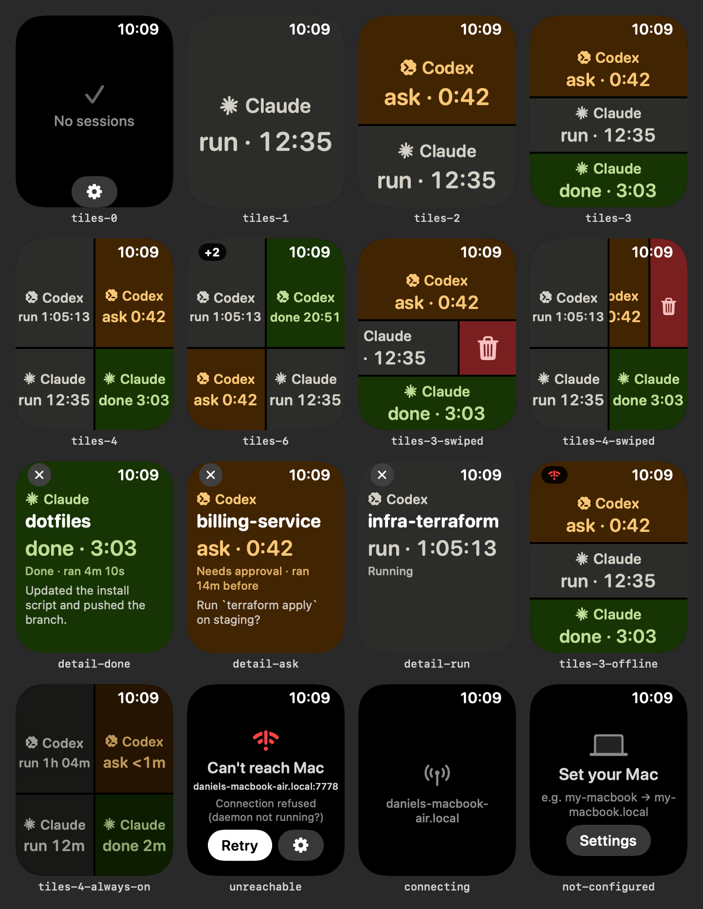
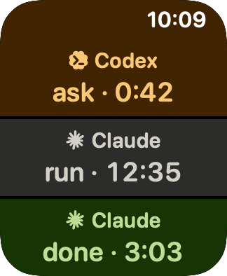
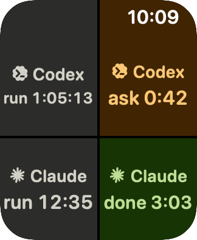
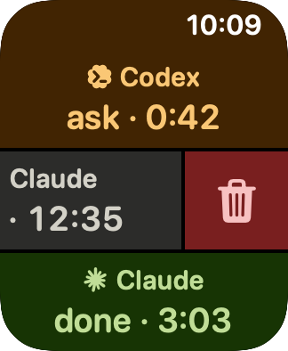
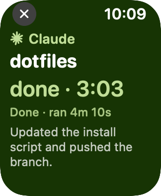

**English** | [简体中文](README.zh-CN.md)

# ai_status — Claude Code / Codex session status on your Apple Watch

Tracks the live state (running / waiting / done) of every Claude Code / Codex session on this machine and serves it over a LAN HTTP API to the Phase 2 watchOS app. Node 22, zero npm dependencies. Design: see [PLAN.md](PLAN.md). For the watch app see [Phase 2: watchOS app](#phase-2-watchos-app) below. Another computer (the Codex desktop app on Windows) can also report its sessions to this Mac, see [Multiple computers (Windows)](#multiple-computers-windows). If you don't want to keep the Mac running as the hub, you can use a cloud hub on Supabase instead, see [Cloud hub (Supabase)](#cloud-hub-supabase).

## Preview

Raise your wrist and see the state of every Claude Code / Codex session at a glance: gray = running, amber = waiting for approval, green = done. The screen splits automatically into 1 / 2 / 3 rows or a 2×2 grid depending on the number of sessions. Tap a tile for details, swipe left to delete.



| Three sessions | 2×2 grid | Swipe to delete | Details |
|---|---|---|---|
|  |  |  |  |

More renders are in `watch/previews/`.


## Install and run

```sh
cd ~/projects/ai_status
npm test                          # unit/integration tests (node:test)
node scripts/e2e.mjs              # optional: end-to-end check in a temporary HOME, does not touch your real config

node bin/aistatus.js install-hooks          # writes ~/.claude/settings.json and ~/.codex/hooks.json (backs them up first)
node bin/aistatus.js daemon                 # run the daemon in the foreground (Ctrl-C to quit)
node bin/aistatus.js                        # in another terminal: live card view (q to quit)
```

- Optionally run `npm link`, after which you can use `aistatus` / `aistatusd` directly.
- `install-hooks` copies the forwarder script to `~/.aistatus/bin/aistatus-hook`, then **merges** the hooks into the config files; before modifying a file it backs up the original to `~/.aistatus/backups/<name>.<timestamp>.json`. Running it again changes nothing (idempotent); `uninstall-hooks` only removes entries whose command contains `aistatus-hook`. Use `--claude` / `--codex` to install only one side, and `--port N` to set the port.
- According to the official docs, Claude Code picks up changes to hooks in settings.json automatically via file watching; if an already-open session does not react, restart that session.
- **Codex needs one extra step**: Codex checks trust for new hooks by hash and skips untrusted hooks. After installing, run `/hooks` in the Codex CLI to review and trust them (CLI path: `/Applications/ChatGPT.app/Contents/Resources/codex-cli/CodexCLI.app/Contents/MacOS/codex`), or confirm when the desktop app shows the hook review prompt. Until they are trusted, the daemon automatically falls back to "watch session files" mode (see below).
- Start at login (optional): `node bin/aistatus.js install-daemon` generates `~/Library/LaunchAgents/com.aistatus.daemon.plist` (**it only writes the file, it does not load it**); then run `launchctl bootstrap gui/$(id -u) ~/Library/LaunchAgents/com.aistatus.daemon.plist` yourself. Logs go to `~/.aistatus/daemon.log`. `--print` prints without writing.

### CLI

| Command | What it does |
|---|---|
| `aistatus` | Live card view (SSE push, timers refresh locally every second) |
| `aistatus list [--json]` | Print the current cards once |
| `aistatus dismiss <id>` | Clear a card; id can be `claude:<sessionId>`, the sessionId, or a unique prefix |
| `aistatus health` | Daemon health info |
| `aistatus daemon [--port N] [--no-bonjour]` | Run the daemon in the foreground |
| `aistatus install-hooks` / `uninstall-hooks` | Install / uninstall the hooks |
| `aistatus install-daemon [--print]` | Generate the launchd plist (does not load it) |
| `aistatus token [--read] [--new [--hooks-only \| --shared]]` | Print the token used by remote hooks (`--read`: the `token` the watch uses); `--new` generates and saves `token`, `--new --hooks-only` generates `hookToken`, `--new --shared` generates `token` and deletes `hookToken` (one token for everything) (see [Multiple computers](#multiple-computers-windows), [Public address](#public-address-tailscale-funnel)) |
| `aistatus remote-setup [--public-url URL]` | Print everything the other computer needs: the Mac's LAN IP, port, token, and the Windows install command; when `publicUrl` is configured, the install command uses `-BaseUrl <public address>` instead |
| `aistatus public-url [URL \| --clear]` | Show / save the public address (e.g. `https://<your-mac>.<your-tailnet>.ts.net`); only used by the CLI, the daemon does not read it |
| `aistatus public-status [--show] [--no-probe]` | Whether the public listener port is running, whether a token is set (the token itself is printed only with `--show`), and whether `/health` is reachable on the local and public addresses |
| `aistatus cloud setup --url URL --hook-token T [--read-token T] [--machine NAME] [--no-probe]` | Cloud mode: hooks are sent to the cloud hub (Supabase Edge Function) instead, see [Cloud hub](#cloud-hub-supabase) |
| `aistatus cloud status [--show] [--no-probe]` / `cloud off` / `cloud on` | Check cloud config and connectivity / switch back to the local daemon / switch back to the cloud |

### Configuration `~/.aistatus/config.json` (everything is optional)

```json
{
  "port": 7778,
  "host": "0.0.0.0",
  "swipeThresholdSec": 60,
  "bonjour": true,
  "token": null,
  "hookToken": null,
  "publicPort": 7779,
  "publicUrl": null,
  "machine": null,
  "codex": { "source": "auto", "pollMs": 1500 },
  "idlePruneHours": 24,
  "subagentTimeoutMin": 30
}
```

- `swipeThresholdSec`: done cards whose run time is below this value get `dismissPolicy = "swipe"`, otherwise `"confirm"`.
- `token`: when set, non-local clients (the watch) must send `Authorization: Bearer <token>` or `?token=<token>`; the local machine is always allowed. It also allows other computers to push hooks (unless a separate `hookToken` is set).
- `hookToken`: used only for other computers pushing hooks (`POST /hook/:tool`). When set, remote hooks must carry it (`token` is then no longer accepted for remote hooks); read endpoints are unaffected. When neither `token` nor `hookToken` is set, remote hooks always get `403`.
- `publicPort`: the public listener port (for tunnels such as Tailscale Funnel). It **binds only to 127.0.0.1** and starts only when a `token` or `hookToken` (of at least 16 characters) is configured; otherwise it does not start and the reason is written to the log. Set it to `false` to turn it off. On this port **no request is trusted based on its source address**, see [Public address](#public-address-tailscale-funnel).
- `publicUrl`: the tunnel's public address (written by `aistatus public-url`), only used by `remote-setup` / `public-status`.
- `machine`: this machine's name in the card's `machine` field; defaults to the hostname with `.local` removed (e.g. `DanieldeMacBook-Air-2`).
- `subagentTimeoutMin`: a session whose main turn has ended but whose subagents are still running stays running; if there are no events at all for this many minutes (e.g. a `SubagentStop` was lost), it is marked done using the time of the last event.
- `codex.source`: `auto` (hooks first, session-file watching as fallback) / `hooks` / `watcher`.
- Environment variable overrides: `AISTATUS_PORT`, `AISTATUS_HOST`, `AISTATUS_PUBLIC_PORT` (`off` to disable), `AISTATUS_BONJOUR=0`, `AISTATUS_CODEX_SOURCE`, `AISTATUS_DIR` (data directory).
- State is persisted in `~/.aistatus/state.json` (atomic writes), so cards survive a daemon restart. A state.json written by an older version (Phase 1/2) loads as is; all sessions in it count as local sessions.
- **After upgrading to this version**: restart the daemon and run `node bin/aistatus.js install-hooks` once more to install the new `SubagentStart` / `SubagentStop` hooks (existing entries are unchanged). In Codex you only need to trust these two **new** entries in `/hooks`; the definitions of entries you already trusted did not change, so their trust is still valid.

## State machine

| Hook event (Claude / Codex) | Result |
|---|---|
| `SessionStart` | Creates the session, idle (not shown); does not change the state of an existing session (compact/resume also fire it) |
| `UserPromptSubmit` | running, records `startedAt`; a done session starts timing again |
| `Notification` (`permission_prompt`, `elicitation_dialog`, `agent_needs_input`) / `PermissionRequest` / `PreToolUse(AskUserQuestion)` | waiting |
| `PostToolUse` / `PostToolUseFailure` / `PermissionDenied` (after waiting) | back to running |
| `SubagentStart` / `SubagentStop` (with `agent_id`) | Records / removes a running subagent of that session |
| `Stop` (subagents still running, e.g. background subagents) | **Stays running**, records the last reply; becomes done only when the last `SubagentStop` arrives (`finishedAt` = that moment, `runDurationMs` counted from `startedAt`) |
| `Stop` / `StopFailure` / Codex `Interrupt` | done, records `finishedAt`, `runDurationMs`, and a summary of the last reply; `StopFailure` / `Interrupt` also clear the subagents |
| `SessionEnd` | A done card is kept (`ended: true`) until cleared, otherwise it is deleted |
| dismiss | Hides the card (the session becomes idle; an ended session is deleted outright). Late events from the same turn will not bring it back; a new prompt will |

The `idle_prompt` `Notification` (the "waiting for input" reminder 60 seconds after completion) is ignored and does not turn done into waiting. If the daemon was down when a session started, the card is created when a later event arrives, with `startedAtApprox: true`.

Keeping subagents from getting stuck: a new `UserPromptSubmit` clears the subagent list; `SessionEnd` clears it too (and marks the session done if the main turn has ended); tool events from inside a subagent (with `agent_id`) do not revive a card that is already done or cleared; if a `SubagentStop` is lost, the session is automatically marked done after `subagentTimeoutMin` (default 30 minutes) with no events. Basis: the Claude Code docs say `SubagentStart` also fires for background subagents, hook events inside a subagent carry `agent_id`, and `Stop` only means the main turn's reply has finished; the Codex docs say subagent hooks use the parent session's `session_id` and carry `agent_id`. Whether Codex subagents can keep running after `Stop` is not documented; the logic is the same for both.

## API (for the watchOS client)

Default `http://<mac>:7778`, bound to `0.0.0.0`. All timestamps are **Unix milliseconds (integers)**; the client does its own timing, and uses `serverTime` in the response to correct clock skew (`offset = serverTime - local receive time`).

### Service discovery

Bonjour: `_aistatus._tcp`, instance name `aistatus@<hostname>`, TXT: `path=/sessions events=/events v=1`.

### `GET /sessions`

```json
{
  "version": 1,
  "serverTime": 1790959466000,
  "swipeThresholdSec": 60,
  "sessions": [
    {
      "id": "claude:2f1c…",
      "tool": "claude",
      "sessionId": "2f1c…",
      "machine": "DanieldeMacBook-Air-2",
      "project": "ai_status",
      "cwd": "/Users/me/projects/ai_status",
      "status": "running",
      "startedAt": 1790959400000,
      "startedAtApprox": false,
      "finishedAt": null,
      "runDurationMs": null,
      "waitingSince": null,
      "waitingReason": null,
      "lastMessage": "fix the failing tests",
      "dismissPolicy": "confirm",
      "interrupted": false,
      "error": null,
      "ended": false,
      "activeSubagents": 0,
      "updatedAt": 1790959420000
    }
  ]
}
```

| Field | Description |
|---|---|
| `id` | Card primary key: `<tool>:<sessionId>` for local sessions, `<tool>@<machine>:<sessionId>` for sessions from other computers (the same sessionId on two computers does not collide). Used for dismiss; clients should treat it as an opaque string |
| `tool` | `claude` \| `codex` |
| `machine` | Name of the computer the session runs on (locally the `machine` config or the hostname; remotely the name provided by the sender, sanitized, ≤32 characters). Older daemons do not have this field |
| `project` / `cwd` | Working directory and its basename |
| `status` | `running` \| `waiting` \| `done` (idle never appears in the list) |
| `startedAt` | Start of the current turn; running shows `now - startedAt`. `null` when done and the start is unknown |
| `startedAtApprox` | `true` means the starting event was missing and `startedAt` is approximate |
| `finishedAt` / `runDurationMs` | Set when done; "how long it has been sitting" = `now - finishedAt` |
| `waitingSince` / `waitingReason` | Set when waiting; reason is `permission` \| `question` \| `input` |
| `lastMessage` | Summary (≤160 characters): question → waiting reason → final reply |
| `dismissPolicy` | `swipe` (short task, can be swiped away directly) \| `confirm` (needs confirmation). Always `confirm` for cards that are not done |
| `interrupted` / `error` | Interrupted / ended with an error |
| `ended` | The session process has exited |
| `activeSubagents` | Number of subagents still running (when >0 the session stays running even if the main turn has ended) |

Sort order: waiting → running → done, and by start time within each group.

### `GET /events` (SSE)

Sends a full snapshot on connect, then **a full snapshot on every change** (same structure as `/sessions`), so there is no incremental merging to do:

```
retry: 2000

event: snapshot
data: {"version":1,"serverTime":…,"sessions":[…]}
```

A `: ping` comment line is sent every 15 seconds as a keep-alive. When the watch cannot keep a long-lived connection in the background, it can fall back to periodic `GET /sessions`.

### `POST /sessions/:id/dismiss`

Clears a card. `:id` is the `id` (URL-encoded, e.g. `claude%3A2f1c…`); a sessionId or unique prefix is also accepted. Success: `200 {"ok":true,"dismissed":{…card…}}`; not found or ambiguous prefix: `404`. The confirmation interaction (`dismissPolicy`) is the client's job; the server does not enforce it.

### `GET /health`

`{"ok":true,"name":"aistatusd","version":"0.1.0","machine":"DanieldeMacBook-Air-2","remoteHooks":false,"pid":…,"startedAt":…,"serverTime":…,"sessions":3,"sseClients":1}`

`remoteHooks`: whether the current process accepts hooks pushed from other computers (`hookToken` or `token` configured). The LAN port also includes `"public":{"listening":true,"port":7779,"read":true,"hook":true}` (the state of the public listener port).

On the public listener port: without a valid token it returns only `{"ok":true}`; with the read token (`token`) it returns the full info above (without `pid` and `public`).

### `POST /hook/:tool`

`:tool` is `claude` or `codex`, the request body is the raw hook JSON. Called by the hook forwarder script; the watch does not need it.

- **Loopback address** (local `aistatus-hook`): always accepted, the session belongs to this machine, `?machine=` is ignored.
- **Other addresses** (other computers): no `hookToken`/`token` configured → `403`; `Authorization: Bearer <hookToken or token>` missing or wrong → `401` (constant-time comparison; hooks **do not accept** `?token=`). Once accepted, the computer name is taken from `?machine=<name>`, then the `X-AIStatus-Machine` request header, and if neither is present the peer's IP; the name keeps only letters, digits, `.`, `_`, `-` (everything else becomes `-`), at most 32 characters.

### `GET /setup/aistatus-hook.ps1`, `GET /setup/install-windows.ps1`

Return these two PowerShell scripts from the repository (`text/plain`, no token needed, they contain no secrets), for the one-line install on Windows. **Served only on the LAN port**, not on the public listener port.

### Errors and authentication

Error responses are `{"error":"…"}`. When `token` is configured, non-local requests with a missing/wrong token get `401`. The rules on the public listener port are different (every request needs a token), see [Public address](#public-address-tailscale-funnel).

## Hook forwarder script

`hooks/aistatus-hook.sh <claude|codex> [port]`: `curl` reads stdin and POSTs to `127.0.0.1` with a 0.5s connect timeout and 2s total timeout, discards all output, and **always exits 0**. When the daemon is not running it returns immediately (measured about 180ms on the first cold start); normal forwarding measured about 10–45ms each. Claude hooks use `timeout: 5`, Codex `timeout: 3` (Codex's SessionEnd limit is 3 seconds). When `~/.aistatus/cloud.curl` exists (`aistatus cloud setup`), it sends to the cloud hub instead, and only sends events that change a card, see [Cloud hub](#cloud-hub-supabase).

## Codex investigation (2026-10-02, read-only)

- This machine has the **Codex desktop app** (`ChatGPT.app` bundles `codex-cli 0.159.0-alpha.12.1`, `originator = codex_work_desktop` in `config.toml`); `codex` is not on the PATH.
- **Lifecycle hooks are supported**: `codex features list` shows `hooks  stable  true`; the hook input schema embedded in the binary includes `SessionStart`, `UserPromptSubmit`, `PreToolUse`, `PermissionRequest`, `PostToolUse`, `PreCompact`, `PostCompact`, `Stop` (with `last_assistant_message`), `SubagentStart`, `SubagentStop`, `Interrupt`, `SessionEnd`; there is **no** `Notification`. The payload is largely isomorphic to Claude Code's (`session_id`, `cwd`, `transcript_path`, `hook_event_name`, `turn_id`…). Configuration lives in `~/.codex/hooks.json` or the `[hooks]` section of `config.toml`; currently neither exists. New hooks need to be trusted (see above).
- **Legacy `notify` is not usable**: `notify` in `config.toml` is already taken by the Codex Computer Use client (`… SkyComputerUseClient turn-ended`), and it can only configure one program and only fires at the end of a turn, so it is not used and was not modified.
- **Session files**: `~/.codex/sessions/YYYY/MM/DD/rollout-<local time>-<uuid>.jsonl`, one `{"timestamp","type","payload"}` per line. Observed types: `session_meta` (`id`, `cwd`, `originator`, `cli_version`), `turn_context`, `response_item`, `world_state`, `token_usage_record`, and under `event_msg`: `task_started`, `item_completed`, `token_count`, `task_complete` (`last_agent_message`, `duration_ms`), `thread_settings_applied`. `session_index.jsonl` only has `id/thread_name/updated_at`. `threads.rollout_path` in `state_5.sqlite` points to these files.
- **Implementation**: hooks are primary; a read-only session-file watcher runs alongside (polls the 7 most recent date directories every 1.5 seconds, reads incrementally): `task_started`→running, `task_complete`→done, `turn_aborted`→done(interrupted), `*_approval_request` / `request_user_input` / `request_permissions`→waiting. Once a session (or the same `transcript_path`) receives a hook event, the watcher stops handling it, to avoid duplicate cards. On startup it only replays files from the last 24 hours, and only restores sessions that are still running or finished within the last 10 minutes.
- **Reliability**: hooks (once trusted) should be on par with Claude; the watcher's running/done is based on actually observed `task_started`/`task_complete`, which is reliable, with ≤1.5s latency. Waiting detection is **unverified**: the approval event names exist in the binary, but none of the existing files on this machine contain approval records, so it cannot be confirmed that they get written to the rollout. Also, Codex has `migrate-rollouts` (migration to paginated history in `thread_history_1.sqlite`) and a not-yet-enabled `background_paginated_rollout_migration` feature, so the rollout file format/existence may change in the future; the watcher would then stop working, while hooks would be unaffected.

## Known limitations

- **Claude permission approvals**: there is no "approval granted" hook, so waiting only returns to running after the approved tool **finishes running** (`PostToolUse`); during a long-running command the card keeps showing waiting.
- **User presses Esc to interrupt Claude**: the docs define `Stop` as "when Claude finishes responding", so it most likely does not fire on interrupt (not tested); the card then stays at running until the next prompt or a manual dismiss. Codex has an `Interrupt` hook and is not affected.
- If the agent process crashes/is killed without a `Stop`/`SessionEnd`, the card also stays and needs a manual dismiss.
- `PostToolUse` triggers one curl per tool call (synchronous, about 10–45ms).
- No authentication by default: anyone on the LAN can read project names, paths and message summaries, and dismiss cards; set a `token` on untrusted networks. Listens on IPv4 `0.0.0.0` only. Remote hooks are off by default and need a token to turn on. The public listener port (`7779`, bound only to 127.0.0.1) does not start without a token, and every request needs a token.
- Whether the session id in Codex hooks matches the one in the session files is unverified (deduplication via `transcript_path` is the fallback); how the hook trust UI appears in the Codex desktop app is unverified.
- Card order and times are given by the server as absolute times; the watch must handle clock skew itself (using `serverTime`).

## Multiple computers (Windows)

Lets another computer (e.g. a **Windows PC with the Codex desktop app**) report its Codex sessions to this Mac. The Mac is the hub: the watch still connects only to the Mac and sees the sessions from both computers. The card UI does not distinguish which computer a session is on (the JSON has a `machine` field, only used to keep session ids from the two computers from colliding).

```
Windows: Codex ─hook→ aistatus-hook.ps1 ─HTTP POST (Bearer token)→ Mac: aistatusd ─→ watch
```

### Prerequisites

- Both computers are on the **same LAN** (same Wi-Fi / router), and Windows can reach the Mac's IP. If a company / school network has client isolation (AP isolation) turned on, the two machines cannot reach each other: use the [Public address](#public-address-tailscale-funnel) instead.
- It is recommended to give the Mac a fixed IP in the router (DHCP reservation); otherwise, when the Mac's IP changes, you have to rerun the install script on Windows (it only changes the config file, the hooks do not need to be trusted again).

### Step 1: on the Mac

```sh
cd ~/projects/ai_status
node bin/aistatus.js token --new --hooks-only   # generate a token, saved as "hookToken" in ~/.aistatus/config.json (mode 600)
# restart the daemon for it to take effect (foreground: Ctrl-C, then node bin/aistatus.js daemon again;
#   launchd: launchctl kickstart -k gui/$(id -u)/com.aistatus.daemon)
node bin/aistatus.js remote-setup                # print the Mac's LAN IP, port, token and the command to run on Windows
```

- `--hooks-only` is recommended: it only protects "other computers pushing hooks"; the watch connects as usual and you do **not** have to enter a token on the watch. If you use `aistatus token --new` instead (saved as `"token"`), LAN reads are protected too, and you must enter that token in the watch settings, otherwise the watch shows a token error.
- The "Daemon:" line at the end of `remote-setup` tells you whether the running daemon has loaded the token (it is good only when it shows `remote hooks enabled`).
- **macOS firewall**: if it is on (System Settings → Network → Firewall), allow `node` to accept incoming connections (if the watch can connect, it is already allowed).

### Step 2: on Windows (PowerShell or cmd)

**Option A: one-line install** (the script is downloaded from the Mac's daemon): paste and run the "one-line install" line printed by `remote-setup` as is; it looks like:

```bat
powershell -NoProfile -ExecutionPolicy Bypass -Command "& ([scriptblock]::Create((New-Object Net.WebClient).DownloadString('http://192.168.1.20:7778/setup/install-windows.ps1'))) -MacHost 192.168.1.20 -Port 7778 -Token 'your-token'"
```

**Option B: copy the files**: copy `hooks\aistatus-hook.ps1` and `scripts\install-windows.ps1` from the repository to Windows, keeping the directory structure (USB stick, shared folder or `git clone` all work), and run in the repository directory:

```bat
powershell -NoProfile -ExecutionPolicy Bypass -File .\scripts\install-windows.ps1 -MacHost 192.168.1.20 -Port 7778 -Token "your-token"
```

Optional parameters: `-Machine OfficePC` (computer name, defaults to the Windows computer name), `-SkipTest` (skip the connectivity test), `-Uninstall` (uninstall).

What the install script does:
1. Writes `%USERPROFILE%\.aistatus\config.json`: `{ "host", "port", "token", "machine" }`;
2. Puts the forwarder script at `%USERPROFILE%\.aistatus\aistatus-hook.ps1`;
3. **Merges** the hooks into `%USERPROFILE%\.codex\hooks.json`: first backs it up to `%USERPROFILE%\.aistatus\backups\codex-hooks.<time>.json`; refuses to modify the file if it is not valid JSON; running it again changes nothing; `-Uninstall` only removes entries whose command contains `aistatus-hook`. The events are exactly the same as the Codex hooks on the Mac: `SessionStart`, `UserPromptSubmit`, `PermissionRequest`, `PostToolUse`, `SubagentStart`, `SubagentStop`, `Stop`, `Interrupt`, `SessionEnd`, `timeout: 3`;
4. Sends a test request (a `SessionStart`, which does not show up as a card) and tells you the result: OK / wrong token (401) / remote hooks not enabled on the Mac (403) / cannot connect (IP, firewall, daemon not running, Mac asleep).

The hook command is a fixed single line (changing the IP/port/token only changes `config.json`; the command stays the same, so Codex will not ask you to trust it again):

```
powershell -NoProfile -ExecutionPolicy Bypass -File "C:/Users/<you>/.aistatus/aistatus-hook.ps1"
```

The forwarder script reads raw bytes from standard input (bypassing the console code page, so Chinese text is not garbled), POSTs to `http://<Mac>:<port>/hook/codex?machine=<computer name>` with `Authorization: Bearer <token>`, with a 1-second network timeout per step and no proxy (when `url` is configured it sends to `<url>/hook/codex?…` instead, 1.4 seconds per step, see [Public address](#public-address-tailscale-funnel)); whether it succeeds or fails, it **produces no output and exits with code 0**, so it never blocks or affects Codex.

### Step 3: trust the hooks in Codex (once)

Codex checks trust for new hooks by the hash of their definition and skips untrusted hooks (nothing gets sent). Open Codex: in the CLI, type `/hooks` to review and trust the 9 aistatus hooks; in the desktop app, confirm when the hook review prompt appears. Then send a message on Windows; the corresponding card should appear on the watch / in `aistatus list`.

### Troubleshooting

- Check the log on the Mac: remote hooks are logged as `hook codex@<computer name> UserPromptSubmit …` (in the terminal when running in the foreground, in `~/.aistatus/daemon.log` with launchd).
- Rerun the install script on Windows to run the connectivity test again. Manual test: `powershell -NoProfile -Command "Invoke-WebRequest -UseBasicParsing http://<Mac IP>:7778/health"`.
- `.local` names do not always resolve on Windows; use an IP for `-MacHost`.

### Not yet verified (no Windows computer here)

The following has only been checked statically (the scripts are pure ASCII; a unit test checks that the event list matches the Mac installer); **the PowerShell scripts have never actually been run** (there is no `pwsh` on this machine either):

- Syntax and behavior of the two `.ps1` files on Windows PowerShell 5.1, including the result of merging `hooks.json` with `ConvertFrom-Json` / `ConvertTo-Json` (`Remove-TypeData System.Array` is used to work around the known 5.1 issue of serializing arrays as `{"value":…,"Count":…}`; files are written without a BOM).
- Which shell Codex uses to run hook commands on Windows is not in the official docs (they only mention an optional `commandWindows` field). The command is written so it parses in cmd, PowerShell and POSIX shells (forward-slash path, quoted), but this has not been tested. If Codex runs the agent inside WSL, the hook most likely runs in Linux and this script does not apply.
- Where the hook trust UI of the Codex desktop app appears on Windows.
- Every hook starts `powershell.exe` once (usually a few hundred milliseconds), and `PostToolUse` fires on every tool call, so Codex waits that much longer each time; it should fit within `timeout: 3`, but the slowest cold-start case has not been measured. The documented `async: true` is not used, because asynchronous execution could reorder events (e.g. a tool event arriving after `Stop`).
- Whether `cwd` in Codex hook payloads on Windows is in `C:\…` form (the project name handles both `\` and `/` separators).

Verified on this machine (`node scripts/e2e-remote.mjs`): using curl against the Mac's LAN IP with exactly the same requests as the PowerShell script (same URL, request headers, raw UTF-8 bytes), covering 403 / 401 / 200, a full Codex turn (including subagents), Chinese text, the same sessionId on two computers not colliding, computer-name fallback and sanitization, dismiss the way the watch does it, persistence across restarts, the sender giving up after about 1 second when the Mac is unreachable, and the two scripts the one-line install command downloads.

## Public address (Tailscale Funnel)

School / company Wi-Fi often blocks devices from reaching each other (client isolation), so neither the watch (via the iPhone) nor the Windows computer can reach port `7778` on the Mac. The fix: use **Tailscale Funnel** to put the daemon on a fixed public HTTPS address, e.g. `https://<your-mac>.<your-tailnet>.ts.net`. Funnel terminates TLS on the Tailscale side and then forwards requests to a port on `127.0.0.1` on the Mac.

```
Watch ─HTTPS─┐                          ┌→ 127.0.0.1:7779 public listener port (every request needs a token)
Windows ─HTTPS┴→ Tailscale Funnel relay ─┘   127.0.0.1/LAN:7778 the original port (behavior unchanged)
```

### Why a separate port

Requests forwarded by a reverse proxy **all appear to come from 127.0.0.1** to the daemon. Port `7778` trusts the loopback address (local hooks and the CLI need no token), so pointing the tunnel at `7778` would let the whole internet read your sessions, push hooks and delete cards. That is why the daemon opens a separate **public listener port** (`publicPort`, default `7779`):

- Binds only to `127.0.0.1`, so it is not reachable from the LAN either; only the tunnel (or local processes) can connect.
- Starts only when a token is configured; without a token it does not start and writes `public listener not started: no token configured…` to the log.
- **Trusts no request based on its source address**: every endpoint requires `Authorization: Bearer <token>` (constant-time comparison); `?token=` is **not accepted**.
- The only exception is `GET /health`: without a valid token it returns only `{"ok":true}`, with no details (handy for checking whether the tunnel works).
- Does not serve `/setup/*.ps1`, nor anything that contains a token.
- Hooks coming in through this port always count as **remote hooks**: the computer name comes from `?machine=` / `X-AIStatus-Machine`, and if neither is present from the client IP appended by the proxy (the rightmost entry of `X-Forwarded-For`), and failing that it is `remote`; they are **never** treated as local sessions (even if the computer name is the same as the Mac's, the id is `codex@<name>:<id>`).
- Hardening: request body limit 1 MiB (hooks; dismiss 16 KiB), exceeding it returns `413`; at most 8 SSE connections at a time, more return `503`; after 10 **wrong-token** attempts within 1 minute from the same client (identified by the rightmost `X-Forwarded-For` entry, or the connection address if absent), it returns `429` until that minute ends (requests with no `Authorization` at all — e.g. scanners — only get `401` and are not counted, so you don't lock your own watch out); 10-second timeout for request headers and 30 seconds for the whole request; at most 64 connections.
- Tokens never appear in the log (query strings are not logged either).
- The behavior of `7778` is **completely unchanged**: local hooks and the CLI still need no token.

### What the tokens mean

| Configuration | Reads on the public port (`/sessions`, `/events`, full `/health`, dismiss) | Hooks on the public port (`POST /hook/:tool`) |
|---|---|---|
| Only `token` | `token` | `token` (one token for everything) |
| `token` + `hookToken` | Only `token` | Only `hookToken` (`token` does not work) |
| Only `hookToken` | All rejected (`401`) | `hookToken` |

- Keeping the two separate is recommended: the watch has only the read token, Windows has only the hook token, so a leak of either has a smaller blast radius. `aistatus token --new` generates `token`, `aistatus token --new --hooks-only` generates `hookToken`; to use a single one, `aistatus token --new --shared`.
- The public port only accepts tokens of at least 16 characters (`--new` generates 32 characters).
- Once `token` is set, reads from the LAN (non-local) also require it (same as before).

### Going live

1. **Mac: generate tokens and restart the daemon**
   ```sh
   cd ~/projects/ai_status
   node bin/aistatus.js token --new                # "token": for the watch (skip if you already have one, otherwise the old token stops working)
   node bin/aistatus.js token --new --hooks-only   # "hookToken": for Windows (skip if you already have one)
   launchctl kickstart -k gui/$(id -u)/com.aistatus.daemon
   node bin/aistatus.js public-status              # should show public listener up on 127.0.0.1:7779
   ```
2. **Mac: turn on Funnel (you run this yourself; aistatus never touches Tailscale)**
   ```sh
   tailscale funnel --bg 7779
   node bin/aistatus.js public-url https://<your-mac>.<your-tailnet>.ts.net
   node bin/aistatus.js public-status              # public probe: … HTTP 200 {"ok":true}, with token: OK
   ```
   Note that it is `7779` (the public listener port); do **not** point Funnel at `7778`.
3. **Watch: build the address and token into the app** (no need to type a 32-character token on the watch)
   ```sh
   cd watch
   ./scripts/generate.sh --host https://<your-mac>.<your-tailnet>.ts.net --token "$(node ../bin/aistatus.js token --read)"
   ```
   Then reinstall to the watch from Xcode. An `https://` address without a port means 443 (the port in settings is only used for LAN http). If you previously changed the host or token in the watch settings, the watch keeps using your values: long-press → Settings, then tap "Use https://…" and "Use built-in token".
4. **Windows: switch to the public address**: `aistatus remote-setup` prints an install command with `-BaseUrl`. The new forwarder script has to get onto Windows (the old one does not understand `url`): while on the same network as the Mac, use the one-line install (it downloads the scripts from the LAN port; the public address does not serve them), or copy `hooks\aistatus-hook.ps1` and `scripts\install-windows.ps1` over and run:
   ```bat
   powershell -NoProfile -ExecutionPolicy Bypass -File .\scripts\install-windows.ps1 -BaseUrl https://<your-mac>.<your-tailnet>.ts.net -Token "<hookToken>"
   ```
   The config file gains a `"url"`, which the forwarder script prefers (`https`, no port, TLS 1.2 explicitly enabled, 1.4-second timeout per step); rerunning with `-MacHost <ip>` and without `-BaseUrl` switches back to the LAN. **The hook command line and `timeout` are unchanged, the entries in `hooks.json` are exactly the same as before, and Codex does not need to trust them again** (as long as the Phase 3 version is already installed on Windows).

### Data passing through third parties

- All traffic goes through Tailscale's Funnel relay servers. According to Tailscale, TLS is terminated by `tailscaled` on your Mac (the certificate and private key are on the Mac), and the relay only forwards the encrypted TCP stream by SNI and cannot see the content; what it can see is connection metadata: the public IPs of the watch / Windows, connection times and traffic volume. Content confidentiality depends on Tailscale's implementation and the Tailscale software itself (`tailscaled` decrypts and then passes it to `127.0.0.1:7779`). The content that passes through includes: project names, session states and times, the last message summary (up to 160 characters), the Windows `cwd` path and computer name, the raw hook JSON (including prompts, tool names, and snippets of tool output), and the tokens (in request headers).
- The public address's hostname appears in public Certificate Transparency logs, so anyone may find it and scan it; without a token they only get `{"ok":true}` and `401`.
- Tokens are only sent over HTTPS; `public-status` only sends the token for its test when the address is `https://`.
- To turn it off: `tailscale funnel --bg 7779 off` (or `tailscale funnel reset`), and optionally set `"publicPort": false` in the config.

Verified on this machine: `test/public.test.js` (does not start without a token, unauthenticated 401, wrong token / `?token=`, reads, the split between `hookToken` and the read token, minimal `/health`, install scripts not served, body limit, SSE limit, wrong-token rate limiting, `7778` behavior unchanged, no tokens in the log); `node scripts/e2e-public.mjs` (a separate daemon + a local reverse proxy simulating Funnel, covering all of the above, remote hooks sent in the PowerShell script's format, SSE push, dismiss the way the watch does it, and the CLI's `public-status` / `remote-setup`); `watch/scripts/check.sh` (`https://` address parsing, Bearer on every request including SSE, `generate.sh` escaping and the Xcode expansion result); a signed watchOS device build with a fake address and fake token, whose built Info.plist contains the full `https://…` and the token.

### Not yet verified

- The real Tailscale Funnel has not been tested here (as instructed, Tailscale was not touched). It was tested on this machine with a local reverse proxy that simulates the tunnel (`scripts/e2e-public.mjs`).
- Whether Funnel adds `X-Forwarded-For` (and whether it is the real client IP) is unconfirmed; if not, all public clients share one "wrong-token counter", and someone deliberately sending wrong tokens could cause your watch to temporarily get `429` too (for at most 1 minute).
- Whether SSE gets buffered when the watch uses HTTPS via the iPhone (there is already a fallback to polling after 8 seconds without a snapshot); Funnel's idle timeout for long-lived connections (the daemon sends a heartbeat every 15 seconds).
- The `url` / TLS 1.2 branch on Windows has never actually run (no Windows / PowerShell here). The forwarder script does not use the system proxy (`Proxy = $null`); if a school network forces an HTTP proxy for internet access, the hooks will not get through.

## Cloud hub (Supabase)

Using the Mac as the hub has two problems: the Mac has to stay on all the time, and the Tailscale Funnel tunnel is unreliable. The cloud hub moves the "hub" to an **Edge Function** on Supabase (free tier): hooks from both the Mac and Windows go straight to it, and the watch reads from it directly, so **no computer needs to stay on and no tunnel is needed**.

```
Mac hooks ─────HTTPS──┐
Windows hooks ─HTTPS──┼→ Edge Function "aistatus" ──→ Postgres table aistatus_sessions
Watch (polling)─HTTPS─┘   https://<ref>.supabase.co/functions/v1/aistatus
```

- **Same protocol**: the function provides the same endpoints and JSON as the daemon (`POST /hook/:tool`, `GET /sessions`, `POST /sessions/:id/dismiss`, `GET /health`), just under the function's address (`<base>/sessions` etc.). There is no SSE: `GET /events` returns `501`, so the watch only polls (see below).
- **The state machine is the same code**: `src/core.js` (plain JS, no Node dependency) is used by both the daemon and the function; `scripts/build-supabase.mjs` concatenates it with `src/hub/*.js` into a single file `supabase/functions/aistatus/index.ts` (committed; tests check that it matches the sources), which you paste in whole into the web editor.
- **Every hook is "remote"** and carries a computer name: session ids on the Mac also become `claude@<Mac name>:<id>` (same as Windows).
- **Tokens** (the function's Secrets, at least 16 characters, constant-time comparison, never in the logs):

  | Secret | Purpose |
  |---|---|
  | `AISTATUS_READ_TOKEN` | Watch / `aistatus list`: `GET /sessions`, dismiss, full `/health` |
  | `AISTATUS_HOOK_TOKEN` | Hooks: `POST /hook/:tool` (when unset, the read token is used; once set, the two are not interchangeable) |
  | `AISTATUS_STORE_DETAILS` | Optional; only when set to `1` are project names (folder name only, never the full path) and message summaries of up to 160 characters stored |

  Same as the public listener port: `?token=` does not work; an unauthenticated `GET /health` returns only `{"ok":true}`; when the tokens are not configured, all other requests return `503`.
- **Minimal data by default**: tool, computer name, session id, state, timestamps, subagent ids. No paths, prompts, messages, tool output or error text are stored. When there is no project name, the watch's detail page shows the computer name.
- **Concurrency**: hooks arrive at the same time (e.g. several subagents starting together). There is one row per session with a `version` column; the function reads `(state, version)`, runs the state machine in JS, then writes back with `UPDATE … WHERE id = $1 AND version = <value read>` (new sessions use `INSERT`, which fails on a primary key conflict); 0 affected rows means someone else wrote in between, so it starts over from the read (up to 30 times, with jittered backoff). Each step is a single SQL statement, and no row lock is held while JS runs (each PostgREST request is a separate transaction, so a `select … for update` lock cannot span the JS step; rewriting the state machine in plpgsql would mean two copies of the logic). In the tests, 12 concurrent hooks hitting the same session lose none; a control experiment with the version check removed does lose some.
- **Table permissions**: RLS is enabled with no policies at all; the `anon` / `authenticated` roles have no table privileges; only the function accesses it, with the project's secret (service_role) key.

### Sender side: only send useful events (saves invocations)

The free tier allows 500,000 function invocations per month, and every hook request counts as one (`401` counts too). So in cloud mode the forwarder script **filters locally first** and only sends events that change a card:

| Event | Sent? |
|---|---|
| `SessionStart`, `Notification` `idle_prompt` / `auth_success`, other unknown events | Never |
| `UserPromptSubmit`, `Stop` / `StopFailure` / `Interrupt`, `SessionEnd`, `SubagentStart` / `SubagentStop`, `PermissionRequest`, permission-type `Notification`, `PreToolUse` for `AskUserQuestion` | Sent |
| `PostToolUse` and other tool activity | Sent once only when a local marker file (`~/.aistatus/marks/<tool>-<session>`) shows that this session is waiting (a permission request was sent) or just had a `Stop` (it may be continuing); the marker is deleted after sending |

- Tool activity and requests over 256 KiB are sent as a tiny JSON only (session id, event name, `agent_id`, `notification_type`, `tool_name`, `cwd`); tool output never leaves the computer.
- The Mac (`hooks/aistatus-hook.sh`) and Windows (`hooks/aistatus-hook.ps1`) use the same table (a test compares the two). The Windows script filters this way no matter where it sends (LAN, Funnel, cloud); the Mac script only filters in cloud mode, and local daemon mode is exactly as before.
- In cloud mode, Mac hooks send synchronously (to preserve order), with a 2-second connect timeout and 2.5-second total timeout; Windows uses 1.4 seconds per step. When the cloud is unreachable, a hook delays at most that one event, always exits 0, and produces no output.

**Estimated usage** (each = one function invocation):

| Source | Count |
|---|---|
| One conversation turn (prompt + completion) | 2 |
| One permission wait (Claude: `PermissionRequest` + permission `Notification` + the first `PostToolUse` after it; Codex one fewer) | 2–3 |
| One subagent (start + stop) | 2 |
| One session ending | 1 |
| Watch screen on with the app in the foreground: one `GET /sessions` every 5 seconds (plus one immediately when you raise your wrist) | 12 / minute |
| Terminal live view `aistatus` (also polls in cloud mode, every 5 seconds by default) | 12 / minute |

A typical day: 3 parallel sessions, 150 turns, 50 permission waits, 30 subagents ≈ 300 + 150 + 60 + 20 ≈ **550 hooks**; 100 wrist raises at about 10 seconds of screen-on each ≈ **300 polls**. In total about **1,000 per day, about 30,000 per month**, which is 6% of the free quota. Worst case: the watch app in the foreground with the screen on for 8 hours ≈ 5,800 per day, which together with the hooks is still only about 200,000 per month. The database has only a few dozen rows and traffic is a few MB per month, far below the free quota (500 MB database, 5 GB egress).

### Watch: polling only

- The function's `GET /events` returns `501`: the watch tries `/events` once on first connect, then only polls `GET /sessions`, never retries SSE, and does **not show** the yellow "polling" marker (in the cloud this is the normal state). The offline marker is only shown after 2 consecutive failed polls.
- **Polls only while the app's screen is on**: it stops when you lower your wrist (`.inactive`, Always-On), and polls once immediately when you raise your wrist and the app is back in the foreground. (Unchanged when connected to the local daemon with working SSE: the connection is kept even with the wrist lowered.)
- Polling interval: watch Settings (long-press) → **Refresh**: 3 / 5 (default) / 10 / 15 / 30 / 60 seconds.
- The address can include a path: `https://<ref>.supabase.co/functions/v1/aistatus`; all requests go under that path.

### Going live

**A. On the Supabase website (you do this)**

1. Open <https://supabase.com/dashboard> and pick a project. You can use an existing project (the table and function names both contain `aistatus`, so they won't clash with anything else), or create a new free project (pick a Region close to you, e.g. Singapore / Tokyo). The `<ref>` in the project address is the part in `https://<ref>.supabase.co`.
2. **Create the table**: left sidebar **SQL Editor** → New query → paste all of `supabase/schema.sql` → **Run**. It can be run repeatedly. `aistatus_sessions` will appear in the **Table Editor** (marked RLS enabled).
3. **Generate two tokens** (in a Mac terminal, run this once for each, and note them down):
   ```sh
   node -e "console.log(require('crypto').randomBytes(24).toString('base64url'))"
   ```
4. **Set the Secrets**: left sidebar **Edge Functions** → **Secrets** → add `AISTATUS_READ_TOKEN` = the first token, `AISTATUS_HOOK_TOKEN` = the second token (if you want to see project names and messages in the watch details, also add `AISTATUS_STORE_DETAILS` = `1`) → Save.
5. **Deploy the function**: **Edge Functions** → **Deploy a new function** → **Via Editor** → enter **`aistatus`** as the function name → delete the template code and paste the **entire contents** of `supabase/functions/aistatus/index.ts` → **Deploy function** (10–30 seconds).
6. **Turn off JWT verification** (required): open the details / settings page of the `aistatus` function, turn off **Verify JWT** (it may also be called "Enforce JWT Verification" / "Verify JWT with legacy secret") and save. Otherwise Supabase rejects every request with `401` before the function runs — our tokens are not Supabase JWTs; the function checks them itself.
   (With the Supabase CLI, the equivalent is `supabase functions deploy aistatus --no-verify-jwt`; the CLI was not used here.)
7. Check: `curl https://<ref>.supabase.co/functions/v1/aistatus/health` should return `{"ok":true}`. `401` means step 6 did not take effect; `404` means the function name or address is wrong.

**B. On the Mac**

```sh
cd ~/projects/ai_status
node bin/aistatus.js cloud setup --url https://<ref>.supabase.co/functions/v1/aistatus \
  --hook-token <second token> --read-token <first token>
node bin/aistatus.js cloud status     # health / hook token / read token should all be OK
node bin/aistatus.js list             # in cloud mode list / dismiss / health / the live view all read from the cloud (--local reads the local daemon)
```

- `cloud setup` writes `~/.aistatus/cloud.json` (for the CLI) and `~/.aistatus/cloud.curl` (for the forwarder script, contains the hook token), both with mode 600, and refreshes `~/.aistatus/bin/aistatus-hook`. **Not a single byte of `~/.claude/settings.json` or `~/.codex/hooks.json` is changed**, and Codex does not need to trust anything again. New events go to the cloud right away (no need to restart Claude / Codex).
- The computer name defaults to this Mac's name; change it with `--machine <name>`.
- The daemon can keep running (it no longer receives hooks, but you can switch back with `cloud off` at any time), or you can stop it: `launchctl bootout gui/$(id -u)/com.aistatus.daemon`. Funnel is no longer needed: `tailscale funnel --bg 7779 off` (run it yourself).
- `cloud status` prints the Windows install command and the watch's `generate.sh` command at the end (add `--show` to display the tokens).

**C. On Windows**

Copy the new `hooks\aistatus-hook.ps1` and `scripts\install-windows.ps1` over (keeping the directory structure), and in PowerShell or cmd:

```bat
powershell -NoProfile -ExecutionPolicy Bypass -File .\scripts\install-windows.ps1 -BaseUrl https://<ref>.supabase.co/functions/v1/aistatus -Token "<second token>"
```

You should see `test: OK, the hub accepted a hook from '<computer name>'` (the test sends an event the function ignores, so no card is created). `-BaseUrl` can now include a path. The hook command line and `timeout` are unchanged, so **Codex does not need to trust them again**.

**D. Watch**

```sh
cd watch
./scripts/generate.sh --host https://<ref>.supabase.co/functions/v1/aistatus --token <first token>
```

Then reinstall to the watch from Xcode (the free developer account's 7-day signing still applies). If you previously changed the host or token in the watch settings: long-press → Settings, then tap "Use https://…" and "Use built-in token".

### Rollback

- **Mac**: `node bin/aistatus.js cloud off`; hooks immediately go back to the local daemon (the daemon must be running). `cloud on` switches back to the cloud (the configuration is kept).
- **Windows**: rerun the install script with the previous address, e.g. `-BaseUrl https://<your-mac>.<your-tailnet>.ts.net -Token "<hookToken>"` or `-MacHost <ip>`. The new script works with the daemon too (the filtering gives the same result for the daemon).
- **Watch**: rerun `generate.sh` with the previous `--host` / `--token` and reinstall, or change it in the watch settings.
- **Code**: the version before this change is tagged `v1-mac-hub-tailscale` (`git checkout v1-mac-hub-tailscale`). The daemon's `state.json` format has not changed.
- **Supabase**: delete the `aistatus` function; in the SQL Editor, `drop table public.aistatus_sessions;`.

### Data passing through third parties

- What Supabase can see: by default only computer names, session ids, states and times (with `AISTATUS_STORE_DETAILS` on, also project folder names and message summaries), plus the IP and time of each request. The hook token / read token are in the request headers (HTTPS).
- In cloud mode, tool activity events are sent only as the slim JSON; other events (prompts, completions, permission requests, etc.) are still sent as the raw hook JSON (which may contain prompts, `cwd`, tool input). **The function discards** those fields before storing, but they do pass through Supabase's network and function runtime.
- Free projects are paused after 7 days without activity (once paused, the function is unavailable too and must be restored on the website); normal hook and watch requests should count as activity (unverified).

### Verified on this machine

- `npm test`: the state machine (`test/store.test.js`, all of the daemon's existing tests), the function's request handling (`test/hub.test.js`: auth matrix, minimal-data / details mode, concurrency races, dismiss, cleanup), the bundled `index.ts` itself (`test/hub-bundle.test.js`: runs the bundle with a fake `Deno` global and a fake supabase-js client that simulates PostgREST, covering environment variables, key selection, `Deno.serve`, concurrency), real forwarder script → local Node server (mounting the same handler) → watch format (`test/cloud.test.js`: event filtering and invocation counts, `cloud setup/status/off/on`, settings files unchanged byte for byte, `list/dismiss/health`, back to the local daemon after `cloud off`), and the Windows script's filter table matching the Mac script's (`test/senders.test.js`, static comparison).
- `watch/scripts/check.sh`: addresses with a path, polling only and never retrying when `/events` returns 404/405/501, no marker while polling, polling stops when the wrist is lowered, polling interval, decoding the snapshot returned by the function (`Fixtures/sessions-cloud.json`, generated and validated by `test/cloud.test.js`), and the expansion of addresses with a path by `generate.sh` and `xcodebuild`; a watchOS device build with a fake address succeeded, and the built Info.plist contains the full `https://…/functions/v1/aistatus`.
- Local trial (no Supabase needed): `AISTATUS_READ_TOKEN=… AISTATUS_HOOK_TOKEN=… node scripts/hub-local.mjs`, then `aistatus cloud setup --url http://127.0.0.1:17810/functions/v1/aistatus …` (http is only allowed for 127.0.0.1 / localhost).

### Not yet verified

- **Has never run on real Supabase** (as instructed, nothing was deployed and no project was connected), and there is no Deno / Docker / Supabase CLI here. Specifically:
  - The Deno adapter (`src/hub/deno-entry.js`): `Deno.serve`, `Deno.env.get`, the `npm:@supabase/supabase-js@2` import style, and the selection between `SUPABASE_SECRET_KEYS` (taking `default`) / `SUPABASE_SERVICE_ROLE_KEY` — all written according to the Supabase docs as of 2026-10, and only run in Node with fake objects.
  - Whether the web editor accepts a 38 KB single file with `// @ts-nocheck` as is (the docs say the editor does type checking).
  - The path the function receives: according to the docs it should be `/aistatus/...`; the handler accepts `/aistatus/...`, `/functions/v1/aistatus/...` and paths without a prefix.
  - The exact name and location of the "Verify JWT" switch on the website (the docs only mention `verify_jwt = false` in `config.toml` and the CLI's `--no-verify-jwt`).
  - `supabase/schema.sql` has never been executed on Postgres (no Postgres here); PostgREST behavior (`update … eq(version) … select()` returning the affected rows, a duplicate insert returning `23505`, `bigint` returned as a JSON number) is simulated based on the docs and the known behavior of supabase-js.
  - Cold-start latency and the latency from your network to Supabase: the Mac hook's total timeout is 2.5 seconds and Windows uses 1.4 seconds per step; events that time out are lost (the card may stay in an old state until the next event).
- The Windows script's new filtering logic has never actually run (no PowerShell here).
- Real polling / wrist-raise behavior on the watch, and the actual effect of stopping polling when `.inactive`.

## Development

```
src/core.js           state machine and hook normalization (plain JS, no Node APIs; shared by the daemon and the Supabase function)
src/store.js          the daemon's SessionStore (wraps core.js)
src/cloud.js          cloud mode: aistatus cloud setup/status/on/off
src/hub/handler.js    cloud hub request handling (Request -> Response, runs on both Deno and Node)
src/hub/supabase-storage.js  storage based on supabase-js (compare version, then write)
src/hub/memory-storage.js    in-memory storage (tests, local trial; same semantics as SQL)
src/hub/deno-entry.js function entry point (Deno.env, createClient, Deno.serve)
src/hub/node-server.js mounts the handler on a Node HTTP server (tests, local trial)
supabase/schema.sql   table creation SQL (idempotent)
supabase/functions/aistatus/index.ts  the generated function file (node scripts/build-supabase.mjs)
scripts/build-supabase.mjs  generates the file above (--check only checks)
scripts/hub-local.mjs local fake cloud (in memory, port 17810)
src/server.js         HTTP / SSE API
src/daemon.js         wiring: persistence, Bonjour, Codex watcher
src/codex-watcher.js  Codex rollout file watcher
src/installer.js      hook install/uninstall, launchd plist
src/cli.js, render.js command line and terminal rendering
hooks/aistatus-hook.sh hook forwarder script
hooks/aistatus-hook.ps1     Windows hook forwarder script (PowerShell 5.1)
scripts/install-windows.ps1 Windows install/uninstall script
scripts/e2e.mjs       end-to-end check (temporary HOME, default port 17778)
scripts/e2e-remote.mjs remote hook end-to-end check (temporary HOME, default port 17790, uses curl against this machine's LAN IP)
scripts/e2e-public.mjs public listener port end-to-end check (temporary HOME, ports 17800/17801/17802, all bound only to 127.0.0.1, with a local reverse proxy simulating Funnel)
test/public.test.js    unit tests for the public listener port
test/hub.test.js, test/hub-bundle.test.js, test/cloud.test.js, test/senders.test.js  cloud hub
```

Tests and e2e only use a temporary HOME; they never modify your real `~/.claude`, `~/.codex`, or load launchd jobs.

## Phase 2: watchOS app

A standalone watchOS app (SwiftUI, **no iPhone companion app needed**, deployment target watchOS 11), plus a WidgetKit widget (Smart Stack / watch face complication). The code is in `watch/`.

> **Status (2026-10-03)**: the UI is the second "single-screen tiles" version (branch `watch-tiles-v2`, see below): fixed positions, showing only the tool and the state timer, dark-toned tiles, tap for details, swipe left to delete. A signed device build has been done with Xcode 27 (Swift 6.4, watchOS 27 SDK), 451 checks pass on macOS, and 40/44 mm preview images were rendered off-screen; **the new UI has not run on a watch yet** (no simulator runtime). See "Not yet verified" below.

### What you see on the watch

**The main screen is a single screen**: no scrolling, no list. The point is to raise your wrist and count how many tasks have finished, without needing to know what each task is. The whole screen is split into tiles by the number of sessions, filling edge to edge, with thin 2 pt black lines between tiles:

| Sessions | Layout |
|---|---|
| 0 | A quiet empty state ("No sessions", a gear button at the bottom) |
| 1 | One tile filling the screen |
| 2 | One horizontal cut: two rows, top and bottom |
| 3 | Two horizontal cuts: three rows, top, middle and bottom |
| 4 | 2×2 grid |
| >4 | The grid shows the first 4, with a small "+N" badge in the top-left corner for how many are not shown |

**Fixed positions**: sorted by session start time (earliest first, ties broken by id), and state changes do not move tiles; rows go top to bottom, the grid goes from top-left to bottom-right. The daemon only provides the start time of the "current turn" (`startedAt` changes on a new prompt), so the watch remembers each session's start time from when it first appeared and keeps using it for as long as the session is in the list — starting a new turn after finishing does not move it either. A session that is deleted and then reappears counts as new and is sorted by its new start time. (After the watch app restarts, it sorts once again by the start times at that moment.) With more than 4, the first 4 in that order are shown.

Each tile has **only two lines**, centered:

1. A small tool icon + the tool name: `Claude` or `Codex` (no project name, no indication of which computer);
2. A state word + a self-running timer: `run · 12:34`, `ask · 0:41`, `done · 3:02` (in the grid the middle dot is dropped: `run 12:34`).
   - **run** (running) → gray: background `#2C2C2A` / text `#D3D1C7`, timed from `startedAt`;
   - **ask** (waiting for approval / input) → amber: background `#412402` / text `#FAC775`, timed from `waitingSince`, or `startedAt` if absent;
   - **done** (finished, including interrupted / errored) → green: background `#173404` / text `#C0DD97`, timed from `finishedAt` (= how long it has been sitting).

Timer format `0:41` / `12:34` / `1:05:12`, and `1d 2h` beyond a day; refreshed every second by `TimelineView`, without needing network updates. In Always-On (`isLuminanceReduced`) the colors are dimmed further and the timer switches to minutes (`run · 12m`, `1h 05m`, refreshed every minute), because the Always-On screen only refreshes about once a minute.

**Tool icons**: monochrome vector shapes (SwiftUI `Shape`, in `AIStatusUI/ToolGlyphs.swift`), tinted with the tile's text color. Claude = a radiating starburst (modeled on the Claude desktop app's menu bar icon); Codex = a wavy-edged "cloud" with a cut-out `>_` prompt (modeled on the Codex icon bundled in the ChatGPT desktop app). Full-color app icons are illegible at about 14 pt on a dark tile, so they are drawn as simplified template shapes. For personal builds only, not for distribution.

**Interactions**:

- **Tap any tile (any state) → detail page** (a single screen, no scrolling): tool + state, project name, state timer (`done · 3:02`), a one-line description ("Done · ran 4m 10s", "Needs approval · ran 14m before"), and the last message (if any, up to 4 lines). The detail page follows live data; tap anywhere on the screen or the system close button to go back.
- **Swipe a tile left → a red trash can is revealed on the right** (background `#791F1F`, icon `#F7C1C1`; half the tile's width, at most 60 pt). Tap the trash can to delete that session (through the existing view model: hidden optimistically first; if `POST /sessions/:id/dismiss` fails it is restored in place with an alert, and 404 counts as already cleared). Swiping right, tapping elsewhere, or 4 seconds of inactivity closes it; only one tile can be open at a time; the same touch that swiped will not also trigger a tap. **Any state can be deleted, and this is the only way to delete** (there is no more "tap once to clear / tap again", and the watch UI no longer uses `dismissPolicy`; VoiceOver has a "Delete" action).
- **Long-press anywhere → Settings** (host / port / token / Test connection, opened as a form sheet). The empty, unreachable and not-configured screens also have a settings button on screen.

**Connection state**: when there are tiles, connection problems only show a small marker in the top-left corner (red Wi-Fi exclamation mark = cannot connect, yellow dot = SSE dropped and polling), and the tiles keep the last data; only when **there are no tiles to show at all** does the full screen show "Can't reach Mac" (address, reason, Retry, gear). On first connect it shows an antenna icon and the hostname; when no host is set, it guides you to Settings.

**Haptics**: while the app is in the foreground, the watch vibrates when a session becomes ask (`.notification`, takes priority) or done (`.success`); the first snapshot when the app opens does not vibrate.

**Make it the default screen (recommended)**: on the watch, Settings → General → Return to Clock → pick AI Status in the app list, turn on "Return to App", and set the return-to-clock time to something longer (option names depend on the watch OS version). That way this screen is what you see when you raise your wrist, and with Always-On you can glance at it any time.

Preview images (rendered off-screen on macOS, 40 mm = 162×197 pt, 44 mm = 184×224 pt; the 10:09 in the top-right corner, the ✕ in the top-left of the detail page, and the rounded corners are simulated system elements and screen shape): [`watch/previews/`](watch/previews) — `tiles-0/1/2/3/4/6`, `tiles-3-swiped` / `tiles-4-swiped` (swiped left to reveal the trash can), `detail-done/ask/run`, `tiles-3-offline`, `tiles-4-always-on`, and the various state pages; for an overview see `overview-40mm.png` / `overview-44mm.png`.

- **Settings**: host, port (default 7778), token (optional), persisted with `@AppStorage`. A bare host name gets `.local` appended automatically (`Daniels-MacBook-Air` → `Daniels-MacBook-Air.local`); IPs, `host:port`, forms with `http://`, and full `https://` addresses (e.g. a Funnel address; without a port it is 443, and the port in settings is then unused) are also accepted; "Test connection" calls `/health`. At build time, `generate.sh` writes the default host (this machine's Bonjour name, or the address given with `--host`) and the token given with `--token` into Info.plist (`AIStatusDefaultHost` / `AIStatusDefaultToken`), so **you usually don't have to type anything on the watch**; values the user changed in settings take precedence, and settings have "Use …" / "Use built-in token" buttons to restore the built-in values. All requests (including SSE) carry `Authorization: Bearer <token>`.
- **Widget**: `accessoryRectangular / Circular / Inline / Corner`, showing running / waiting / done counts and an "as of time"; the data comes from the snapshot the app last wrote to the App Group (the timeline is only refreshed when the counts change). The widget does not go online itself, so it is only as fresh as the last time you opened the app (background refresh is Phase 3).

### Networking

- In the foreground it connects to `GET /events` with `URLSession.bytes` (SSE, parsed byte by byte by hand, because `AsyncBytes.lines` swallows empty lines); if the first snapshot does not arrive within 8 seconds (e.g. a proxy buffers the stream) or the connection drops → it immediately falls back to polling `GET /sessions` (every 5 seconds), while reconnecting SSE with exponential backoff (1→2→4…30 seconds, ±20% jitter); offline is only shown after 2 consecutive failures. SSE idle for 40 seconds (the daemon pings every 15 seconds) counts as disconnected.
- When the app goes to the background (`scenePhase == .background`) it disconnects; it reconnects automatically when you raise your wrist again.
- When the server has no SSE (`/events` returns 404 / 405 / 501, e.g. the [Cloud hub](#cloud-hub-supabase)), it only polls (interval in Settings → Refresh, default 5 seconds), shows no polling marker, and also stops polling when the wrist is lowered (`.inactive`). The host can be a full address with a path (`https://<ref>.supabase.co/functions/v1/aistatus`).
- Clock skew: for every snapshot, the difference between `serverTime` and the local receive time (for polling, the midpoint of the round trip) is computed, the median of the last 5 samples is taken, and all timestamps are converted to local time before being handed to the timer text.
- No Bonjour browsing: regular watchOS apps basically cannot use Network.framework's NWBrowser/NWConnection, so a manual host is the baseline.
- Info.plist: `NSAppTransportSecurity → NSAllowsLocalNetworking = YES` (allows cleartext HTTP to `.local`, dotless host names and LAN IPs; `NSAllowsArbitraryLoads` is **deliberately not** added, since the latter is ignored when both are present; public `https://` addresses are allowed anyway and need no exception), `NSLocalNetworkUsageDescription`, `NSBonjourServices = _aistatus._tcp`, `WKApplication`, `WKWatchOnly`.
- The daemon API **needed no changes**; Phase 1's `/sessions`, `/events`, `/sessions/:id/dismiss`, `/health` and Bearer token are sufficient.

### Directory layout

```
watch/
  project.yml                 XcodeGen spec: watchOS app AIStatus + widget extension AIStatusWidget, App Group
  Config/Base.xcconfig        bundle ID prefix, App Group, default host, team (can be overridden by Local.xcconfig)
  App/                        @main (only hosts AIStatusRootView), Info.plist, entitlements, icons
  Widget/                     WidgetKit extension (@main WidgetBundle + TimelineProvider)
  scripts/generate.sh         writes Config/Local.xcconfig (first run) and runs xcodegen
  scripts/check.sh            all checks that don't need a watch (on macOS)
  previews/                   40/44 mm off-screen rendered preview images (each session count, swipe to delete, detail pages, Always-On, offline, state pages)
  AIStatusKit/                Swift package (swift build works on macOS)
    Sources/AIStatusKit       models/decoding, SSE parsing, Endpoint, URLSession transport, connection loop, clock, fixed ordering (SessionOrder), view model, App Group storage;
                              Tiles.swift: tile layout (session count → layout, first 4 + "+N", tile geometry), tile text (run/ask/done + timer), swipe-to-delete state machine, minute format for Always-On
    Sources/AIStatusUI        all SwiftUI views: RootView (single screen + settings sheet), TileBoard (tiles, swipe, detail sheet), SessionDetail (detail page),
                              ToolGlyphs (Claude / Codex monochrome icons), StateViews (empty/unreachable/connecting/not configured),
                              SettingsView, WidgetViews, Samples (preview data and render catalog); watch-only APIs are inside #if os(watchOS)
    Sources/AIStatusChecks    executable test program (neither XCTest nor Swift Testing is available with the command line tools)
    Fixtures/                 JSON / raw SSE bytes captured from a real aistatusd
    scripts/capture-fixtures.mjs   recapture the fixtures (temporary HOME, Bonjour off, port 17779)
    scripts/live-check.mjs         run Swift integration checks against a real daemon (temporary HOME, port 17780, restarts the daemon midway)
```

### Verification without a watch

```sh
cd ~/projects/ai_status/watch
./scripts/check.sh                              # swift build + 451 checks + type-checking the App/Widget entry points on macOS + plist/YAML syntax
node AIStatusKit/scripts/live-check.mjs         # 32 more: SSE, polling, dismiss, reconnect after restart, LAN token against a real aistatusd process
RENDER_DIR=previews AIStatusKit/.build/debug/AIStatusChecks   # regenerate the preview images under previews/ (macOS rendering, timers use "now")
# watchOS device build (signed, not installed):
xcodebuild -project AIStatus.xcodeproj -scheme AIStatus -destination 'generic/platform=watchOS' \
  -derivedDataPath DerivedData -allowProvisioningUpdates build
```

The checks cover: session count → layout (0/1/2/3/4/>4), fixed ordering by start time (no moving on state changes / new turns, a session that reappears after deletion uses its new time, ties broken by id) and first 4 + "+N", tile geometry (fills the screen, text area inside the safe area and the same size, thin dividers), tile text (run/ask/done, `run · 12:34`, no dot in the grid, minutes in Always-On, timer start points), the swipe-to-delete state machine (follows the finger with limits, opens only past halfway or on a fast fling, vertical drags don't count, only one open at a time, closes on swipe right / tap elsewhere / 4-second timeout, no timeout while the finger is down, touches cancelled by the system, the tap from the same touch as a swipe is ignored, only an open trash can deletes, deletes once, closes when the tile disappears), deleting sessions in any state through the view model (optimistic removal, restored in place on failure), and rendering every screen at 40/44 mm sizes.

### After installing Xcode: steps to get it onto the watch

1. **Xcode**: after installing, open it once, accept the license, and install the **watchOS** platform under Settings → Components. In a terminal run `sudo xcode-select -s /Applications/Xcode.app/Contents/Developer` (you need to enter your password yourself), then confirm with `xcodebuild -version`.
2. **XcodeGen**: `brew install xcodegen` (without Homebrew, download `xcodegen.zip` from https://github.com/yonaskolb/XcodeGen/releases and put `xcodegen` on your PATH).
3. **Generate the project**:
   ```sh
   cd ~/projects/ai_status/watch
   ./scripts/generate.sh                 # the first run writes Config/Local.xcconfig:
                                         #   BUNDLE_ID_PREFIX = dev.<your-username>
                                         #   AISTATUS_DEFAULT_HOST = <scutil --get LocalHostName>.local
   open AIStatus.xcodeproj
   ```
   Optional: `./scripts/generate.sh --team ABCDE12345 --host my-mac.local --prefix com.yourname`; public address and token: `--host https://mac.tailnet.ts.net --token <output of aistatus token --read>` (`--token ""` removes it). Options you don't pass keep their existing values in `Local.xcconfig`. In xcconfig `//` starts a comment, so the script writes each `/` as `/$()` (`https:/$()/$()host`, which Xcode expands to `https://host`); `Local.xcconfig` has mode 600 and is not committed, and the script output does not show the token. Project changes go only into `project.yml`, then rerun `generate.sh` (the `.xcodeproj` is not committed).
4. **Signing**: select the `AIStatus` target → Signing & Capabilities → choose your Personal Team as the Team; do the same for the `AIStatusWidget` target. If it says the bundle ID is taken, regenerate with a different prefix via `--prefix`. To avoid picking the team again after every regeneration, write the team ID in (after choosing the team in Xcode, it is the value of `DEVELOPMENT_TEAM` in Build Settings): `./scripts/generate.sh --team <ID>`.
5. **Run it once in the simulator first** (optional but recommended): choose the `AIStatus` scheme and any Apple Watch simulator as the destination, ⌘R. The simulator runs on the same machine as the Mac, so entering `localhost` or `127.0.0.1` as the host is enough to verify the UI and networking.
6. **Developer Mode on the watch**: connect the iPhone to the Mac with a cable and "Trust This Computer"; the paired watch shows up in Xcode → Window → Devices and Simulators (the first time, "preparing device / copying symbols" takes a while; the watch should be charging, unlocked, and near the iPhone). On the iPhone, turn on Settings → Privacy & Security → Developer Mode and restart; on the watch, turn on Settings → Privacy & Security → Developer Mode and restart, confirming as prompted.
7. **Install to the watch**: scheme `AIStatus`, choose your Apple Watch as the run destination, ⌘R. If the watch/phone says the developer is untrusted: on the iPhone, Settings → General → VPN & Device Management → trust your developer certificate.
8. **On the Mac**: `node bin/aistatus.js daemon` (or keep it running with launchd as in Phase 1). If the macOS firewall pops up, allow `node` to accept incoming connections. First open `http://<LocalHostName>.local:7778/health` in the iPhone's browser to confirm the LAN is reachable.
9. **On the watch**: open AI Status. The default host is already this machine's name; if it is wrong, **long-press the screen** (or tap the gear on the unreachable/empty screen) to open Settings, change the host, and tap "Test connection". If you set a `token`, enter it in Settings.
10. **Make it the default screen**: on the watch, Settings → General → Return to Clock → choose AI Status and keep it open (Return to App). It is there whenever you raise your wrist.
11. **Widget**: long-press the watch face → Edit → choose AI Status among the complications; or add it to the Smart Stack. Open the app once first so the widget has data.

### Not yet verified (no simulator runtime, not installed on a watch)

- **Verified**: XcodeGen generates the project; with Xcode 27 / watchOS 27 SDK the signed device build of the app + widget succeeds with no compiler warnings (including the `#if os(watchOS)` branches: haptics, `.textInputAutocapitalization`, widget families); the asset catalog compiles through `actool`.
- **How the new UI actually behaves on the watch** (the preview images are macOS renders; font metrics and control appearance differ slightly from the watch):
  - Position of the system clock and the top safe area: the layout is computed from the runtime safe area (top-row tiles extend under the clock, text stays inside the safe area); the previews assume 28 pt at the top for 40 mm and 31 pt for 44 mm, and the screen corner radii are estimates; "+N" and the offline marker sit in the top-left corner next to the clock, and whether they collide with system elements on a real device remains to be seen.
  - Gestures: each tile has `LongPressGesture(0.5 s).exclusively(before: TapGesture)` plus a simultaneous `DragGesture(minimumDistance: 8)`. Whether swiping left feels right on the narrow tiles of the 2×2 grid (about 80 pt wide, 40 pt trash can), whether a tap with slight movement gets treated as a drag (or vice versa), whether a swipe accidentally opens the details (the state machine has a 0.35-second guard), whether long-press for settings is still reliable, and whether tiles snap back when the system cancels a touch all need confirming on a real device; also the system close buttons of the detail sheet and the settings sheet.
  - Haptics: how `.notification` / `.success` actually feel.
  - Always-On: the dimmed palette under `isLuminanceReduced`, whether the minute timer from `TimelineView(.everyMinute)` refreshes as expected; with the screen normally on, `TimelineView(.periodic)` ticking every second (and its battery use).
  - How the dark-toned tiles look on OLED, and whether the tool icons are clearly recognizable at about 13 pt (they are in the previews).
- Networking on the watch: whether `URLSession.bytes` streaming SSE gets buffered on the watch (especially through the iPhone's Bluetooth proxy) (there is already a fallback to polling if no first snapshot arrives within 8 seconds); whether `.local` names resolve through the proxy; whether the local network permission prompt appears on watchOS.
- Whether a Personal Team (free account) can use an App Group is unconfirmed. If signing fails because of the App Group: delete the two `CODE_SIGN_ENTITLEMENTS` lines in `project.yml` and regenerate; the app works as usual, only the widget will keep showing "Open the app once".

### Known limitations

- Only online in the foreground: once the wrist is lowered and the app goes to the background it stops updating; the widget/complication only shows the counts from the last time you opened the app; no push notifications (Phase 3).
- ATS only allows cleartext HTTP on the local network: `xxx.local`, dotless names and IPs work; `http://` to DNS names like `mac.lan` or `*.home.arpa` is blocked, so use a `.local` name or an IP (`https://` addresses are unaffected). If `.local` does not resolve on the watch, use the Mac's LAN IP instead (giving the Mac a fixed IP in the router is recommended).
- Provisioning profiles from a free Personal Team expire after 7 days, after which you need to reinstall from Xcode.
- The token is stored in UserDefaults (required by `@AppStorage`), not the Keychain; when built into the app with `--token`, it is written in plain text into the app bundle's Info.plist (it is only installed on your own watch, but anyone who gets this .app can read it, so do not distribute the build products). LAN `http://` is cleartext and only suitable for a trusted LAN; use an `https://` address over the internet.
- The watch's ordering (by start time, fixed positions) differs from the server's `/sessions` ordering, on purpose; the "start time at first appearance" is only kept in memory, so after the app restarts it re-sorts by the start times at that moment.
- With more than 4 sessions, only the 4 that started earliest are shown; the rest only count toward "+N" and cannot be seen or deleted on the watch (they move up once earlier ones are deleted; you can also use `aistatus dismiss`).
- Clock correction precision is roughly the one-way LAN latency (milliseconds), which is plenty for second-level timers.
